# Binary Media Art

카메라에 비친 내 모습이 컴퓨터 안에서 **숫자**가 되는 과정을 보여주는 미디어 아트 전시물입니다.
터치 화면 앞에 서서 모드를 고르면 같은 장면이 **0과 1**, **빛 세 장**, **밝기 계단**, **계산된 숫자**로 바뀝니다.

**[소개 사이트](https://bssmascending.github.io/media-art-for-windows/)** · **[패치노트](https://bssmascending.github.io/media-art-for-windows/patch-notes.html)** · **[설치 파일](https://github.com/BSSMAscending/media-art-for-windows-releases/releases/latest)**

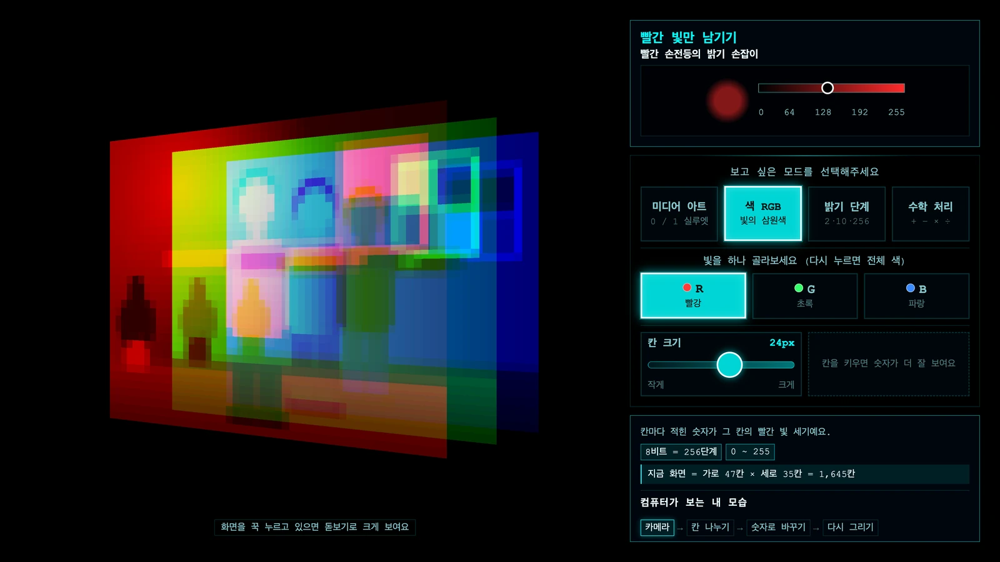

> README의 화면은 실제 카메라 대신 그린 가상 장면(팔을 벌린 사람)과 가상 인물 인식 결과로 캡처했습니다.

## 한눈에 보기

| 미디어 아트 | 색 RGB |
| :---: | :---: |
| 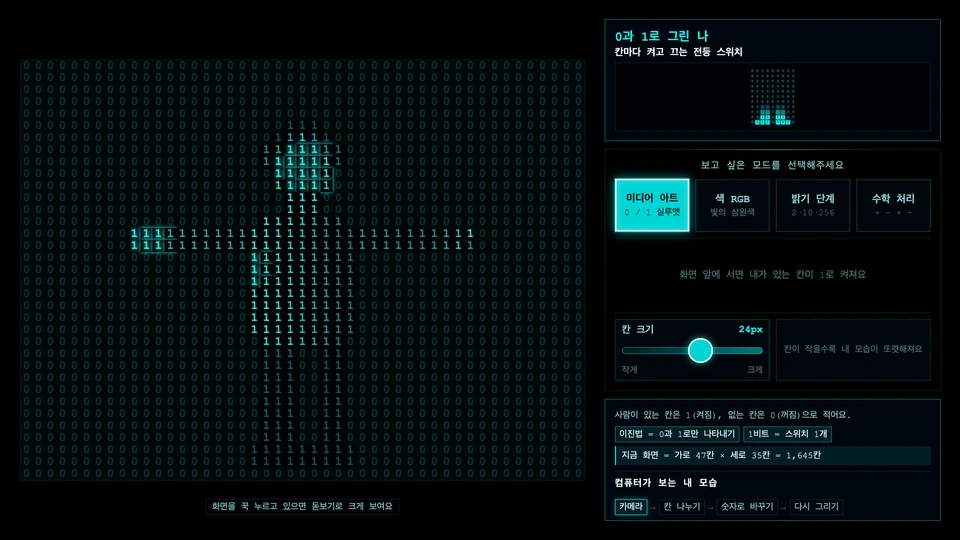 | 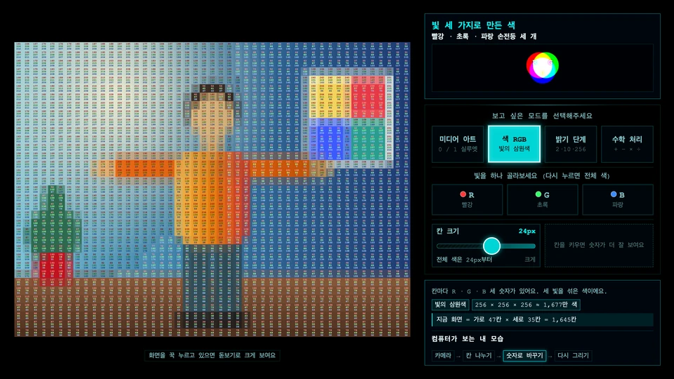 |
| 사람이 있는 칸은 **1**, 없는 칸은 **0** | 칸마다 **빨강 · 초록 · 파랑** 빛의 세기 |
| **밝기 단계** | **수학 처리** |
| 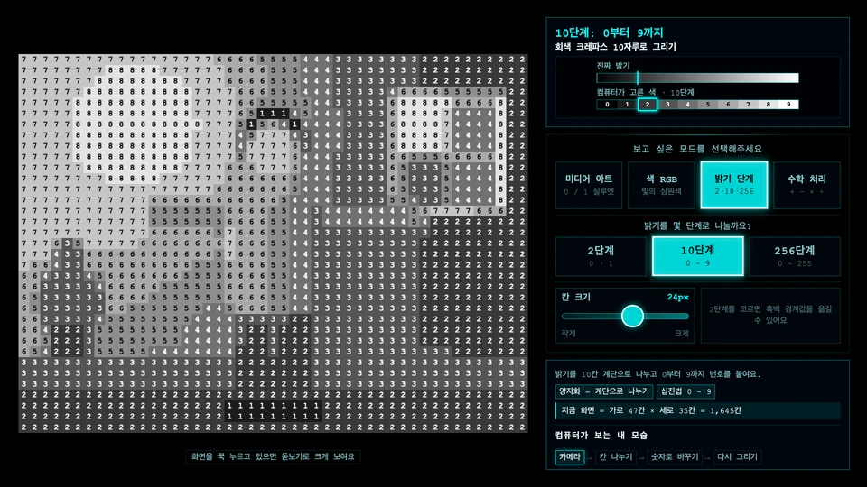 | 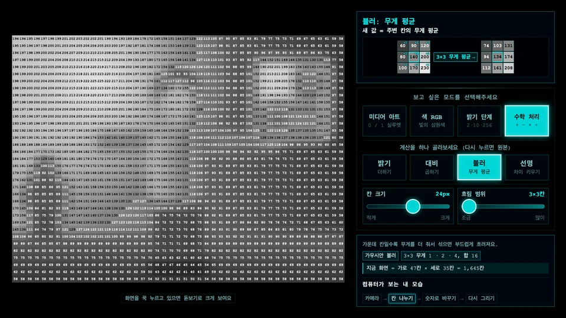 |
| 밝기를 **2 · 10 · 256단계**로 나눈 번호 | **밝기 · 대비 · 블러 · 선명** 계산 전후의 숫자 |

모든 화면은 카메라를 **숫자가 적힌 픽셀 칸**으로 보여줍니다. 칸 크기는 레버로 바꾸고, 작은 숫자는 화면을 꾹 눌러 돋보기로 봅니다.

## 화면 구성

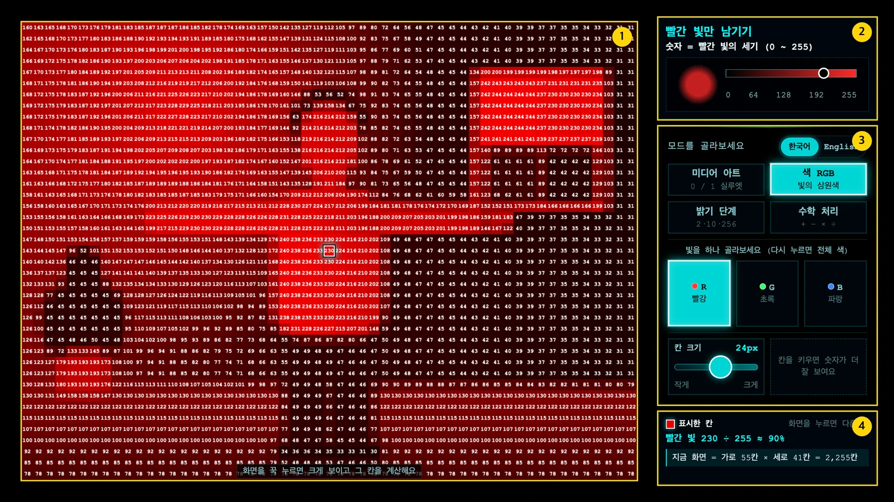

그림의 번호는 아래 목록의 번호와 같습니다.

1. **작품 화면**: 모든 모드가 같은 자리에 카메라 화면 전체를 칸으로 맞춰 그립니다. 누르고 있으면 돋보기가 뜹니다.
2. **비유 · 애니메이션**: 지금 화면의 원리를 그림 하나로 보여줍니다.
3. **버튼과 레버**: 모드 버튼, 세부 버튼, 레버 두 개가 화면 세로 정가운데에 모여 있습니다. 모드를 바꿔도 위치는 그대로입니다.
4. **설명 · 용어 · 지금 화면**: 한 줄 설명, 용어, 지금 화면의 칸 수, 화면이 만들어지는 순서를 보여줍니다.

## 모드

### 미디어 아트: 0과 1로 그린 나

인공지능이 사람을 찾은 칸은 `1`, 나머지 칸은 흐린 `0`으로 화면 전체를 채웁니다. 아무도 없으면 화면이 `0`으로 가득 차고, 사람이 들어오면 그 자리만 `1`로 켜집니다.

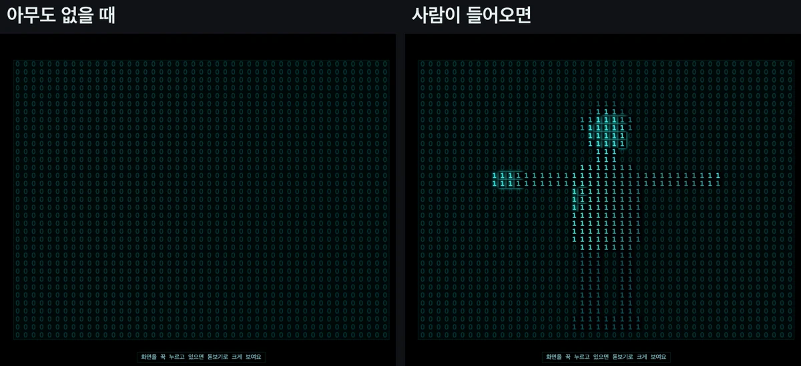

### 색 RGB: 빛 세 가지로 만든 색

`R`/`G`/`B`를 누르면 빛 세 장이 옆으로 벌어진 뒤 고른 빛만 남고, 같은 버튼을 한 번 더 누르면 다시 합쳐집니다.

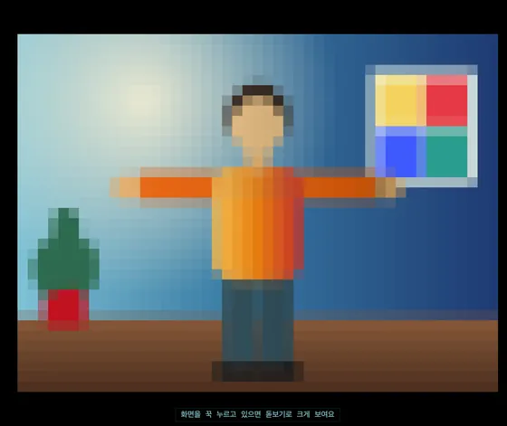

고른 빛만 남기면 칸마다 그 빛의 세기(`0`~`255`)가, 전체 색에서는 R · G · B 세 숫자가 그 빛의 색으로 적힙니다. 세 숫자가 들어가도록 전체 색은 칸 크기가 24px 아래로 내려가지 않습니다.

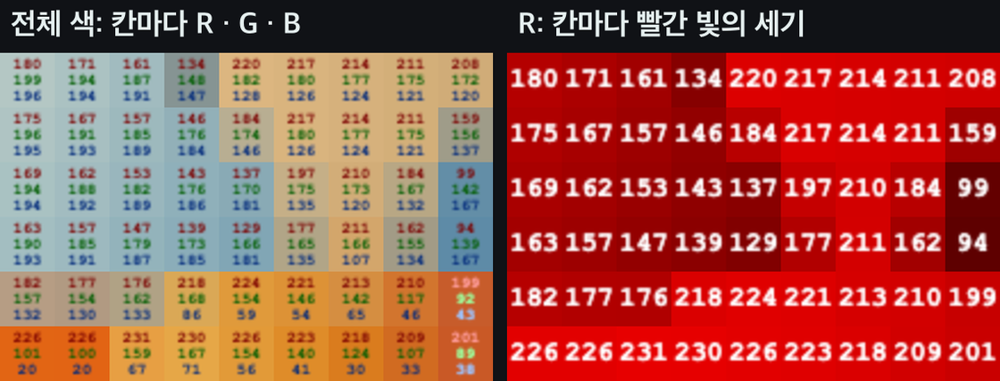

### 밝기 단계: 크레파스 몇 자루로 그릴까

밝기를 계단처럼 나누고 칸마다 단계 번호를 적습니다. 단계가 많을수록 사진에 가까워집니다.

| 2단계 (`0`·`1`) | 10단계 (`0`~`9`) | 256단계 (`0`~`255`) |
| :---: | :---: | :---: |
| 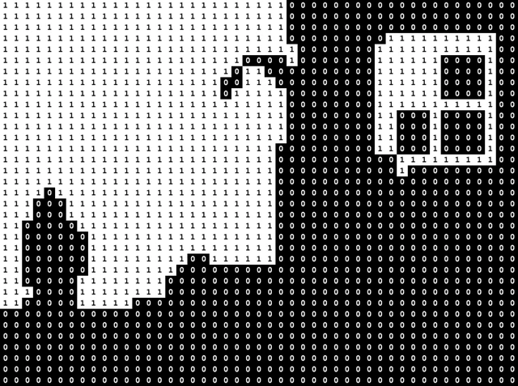 | 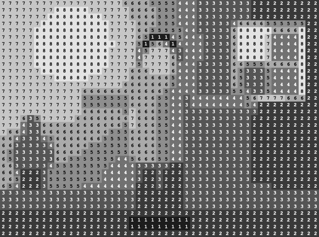 | 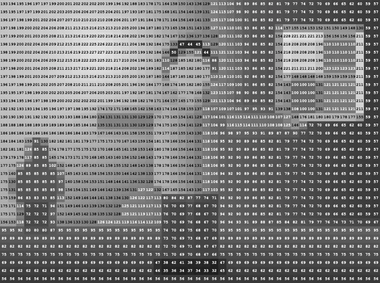 |

2단계에서는 오른쪽 레버로 **흑백 경계값**(`0`~`255`)을 옮깁니다. 경계값보다 밝은 칸은 `1`, 어두운 칸은 `0`입니다.

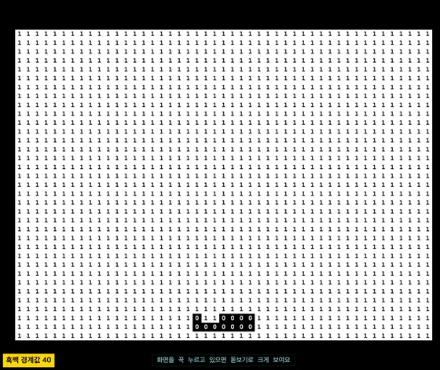

### 수학 처리: 숫자를 계산하면 사진이 바뀐다

회색 칸의 숫자에 계산을 하나 적용합니다. 같은 버튼을 다시 누르면 원본 숫자로 돌아가고, 오른쪽 레버로 세기를 바꿉니다.

| 계산 | 새 값 | 레버 |
| --- | --- | --- |
| 밝기 | 값 + 더할 수 | −120 ~ +120 |
| 대비 | (값 − 128) × 곱할 수 + 128 | × 0 ~ 3 |
| 블러 | 주변 칸의 **가우시안 무게 평균** (3×3: 모서리 1 · 옆 2 · 가운데 4 ÷ 16) | 3×3 · 5×5 · 7×7 |
| 선명 | 값 + (값 − 3×3 무게 평균) × 세기 | × 0 ~ 3 |

결과는 반올림하고 `0`~`255` 안으로 자릅니다.

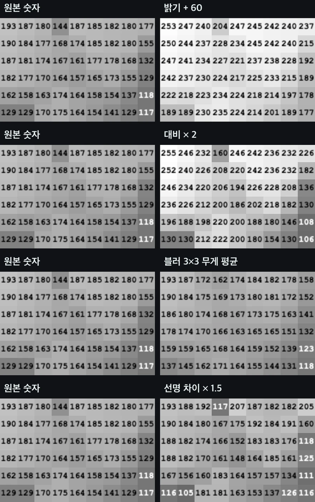

설명 카드는 한 줄 공식과 3×3 예시로 계산을 보여줍니다. 예시는 화면과 같은 계산 함수를 쓰고, 레버를 움직이면 같이 바뀝니다.

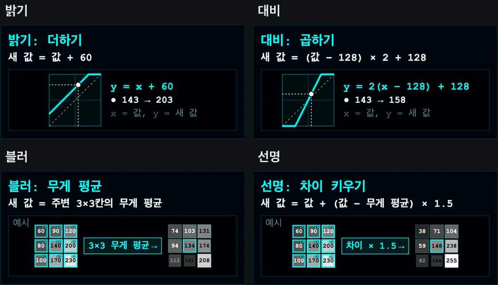

## 레버

버튼 아래에 큰 레버 두 개가 나란히 있습니다.

- **왼쪽 · 칸 크기**: 모든 모드에서 8~48px 칸을 고릅니다. 처음에는 24px이고, 숫자가 7px보다 작아지는 칸은 색만 칠합니다.
- **오른쪽 · 지금 화면의 레버**: 밝기 2단계의 흑백 경계값, 수학 처리의 세기처럼 화면마다 바뀝니다. 레버가 없는 화면에서는 같은 자리에 짧은 안내가 있습니다.

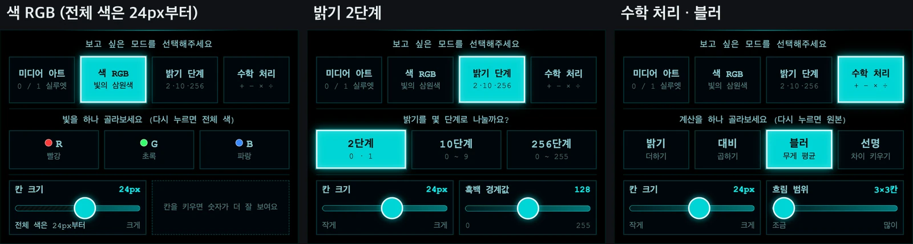

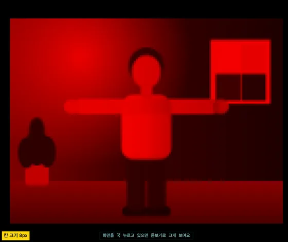

## 돋보기

작품 화면을 누르고 있으면 손가락 위에 3배 돋보기가 떠서 작은 숫자도 읽을 수 있습니다. 누르고 있는 동안 손가락을 따라 움직이고, 떼면 사라집니다.

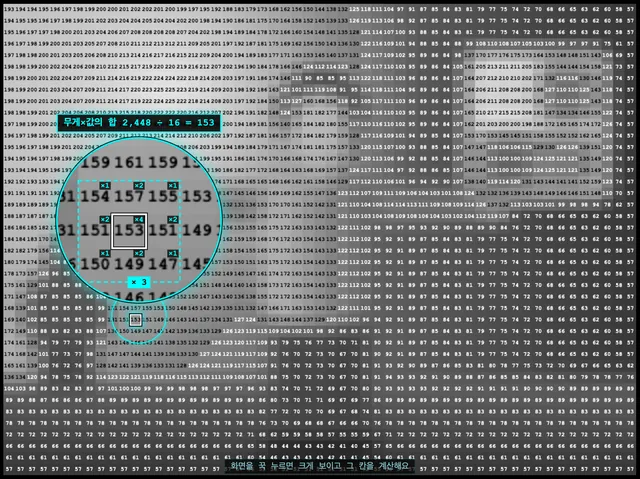

## 설명 카드

수식 대신 비유와 짧은 애니메이션으로 원리를 보여줍니다. 오래 읽지 않아도 감으로 익힐 수 있게 문장은 한 줄로 줄였습니다.

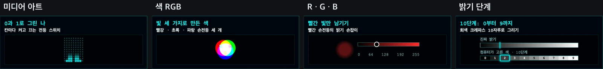

## 조작

| 하고 싶은 것 | 터치 | 키보드 |
| --- | --- | --- |
| 모드 고르기 | `미디어 아트` / `색 RGB` / `밝기 단계` / `수학 처리` | `1` / `2` / `3` / `4` |
| 빛 하나 고르기 · 풀기 | `R` / `G` / `B` (한 번 더 누르면 전체 색) | |
| 밝기 단계 고르기 | `2단계` / `10단계` / `256단계` | |
| 계산 고르기 · 풀기 | `밝기` / `대비` / `블러` / `선명` (한 번 더 누르면 원본) | |
| 칸 크기 · 세기 바꾸기 | 레버 | |
| 크게 보기 | 작품 화면을 꾹 누르기 | |
| 한국어 / English | 버튼 묶음 첫 줄의 `한국어` / `English` | |
| 종료 | | `Esc` |

## 실행

```bash
npm install
npm start
```

## 개발

```bash
npm test
npm run lint
```

- **문구 고치기**: 설명 카드 문구는 [src/renderer/data/modeExplanations.js](src/renderer/data/modeExplanations.js), 모드 · 세부 버튼 · 레버는 [src/renderer/data/modeOptions.js](src/renderer/data/modeOptions.js)에 있습니다.
- **칸 크기**: 처음 크기는 [src/renderer/config.js](src/renderer/config.js)의 `FONT_SIZE`(`24px`), 레버의 단계는 `CELL_SIZES`입니다.
- **카메라 해상도**: [src/renderer/core/camera.js](src/renderer/core/camera.js)에서 `640×480`을 요청합니다.
- **숨은 모드**: 키보드 `5`~`9`는 예전 모드(부산 수학문화관, 픽셀 수치, RGB, 8비트 회색, 4비트 컬러)입니다.
- **배포**: `package.json` 버전을 올리는 bump 커밋과 [CHANGELOG.md](CHANGELOG.md) 새 항목을 함께 `main`에 병합하면 배포됩니다. 자세한 순서는 [docs/windows-distribution.md](docs/windows-distribution.md)에 있습니다.
- **소개 사이트**: [site/](site/)의 페이지와 README 스크린샷, `CHANGELOG.md`로 만든 패치노트를 `npm run site`가 `_site/`에 묶습니다. `main`에 병합하면 `.github/workflows/pages.yml`이 GitHub Pages에 올립니다.

### 코드 구조

| 위치 | 하는 일 |
| --- | --- |
| `src/renderer/renderer.js` | 상태, 버튼, 레버, 돋보기, 카메라 시작을 묶는 진입점 |
| `src/renderer/core/frameLoop.js` | 매 프레임 카메라를 칸으로 나눠 모드별로 그림 |
| `src/renderer/core/channelOverlay.js` | WebGL로 칸 색과 RGB 레이어를 그림 |
| `src/renderer/core/imageMath.js` | 수학 처리 계산(밝기 · 대비 · 가우시안 블러 · 선명) |
| `src/renderer/modes/` | 모드별 칸 · 숫자 그리기와 RGB 전환 애니메이션 |
| `src/renderer/ui/` | 설명 카드, 애니메이션, 레버, 돋보기 |
| `src/renderer/data/` | 모드 · 버튼 · 레버 규칙과 설명 문구 |
| `site/`, `scripts/build-site.js` | 소개 사이트와 패치노트 페이지 |
