# Binary Media Art

카메라에 비친 내 모습이 컴퓨터 안에서 **숫자**가 되는 과정을 보여주는 미디어 아트 전시물입니다.
터치 화면 앞에 서서 모드를 고르면, 같은 장면이 **0과 1**, **빛 세 장**, **밝기 계단**으로 바뀝니다.

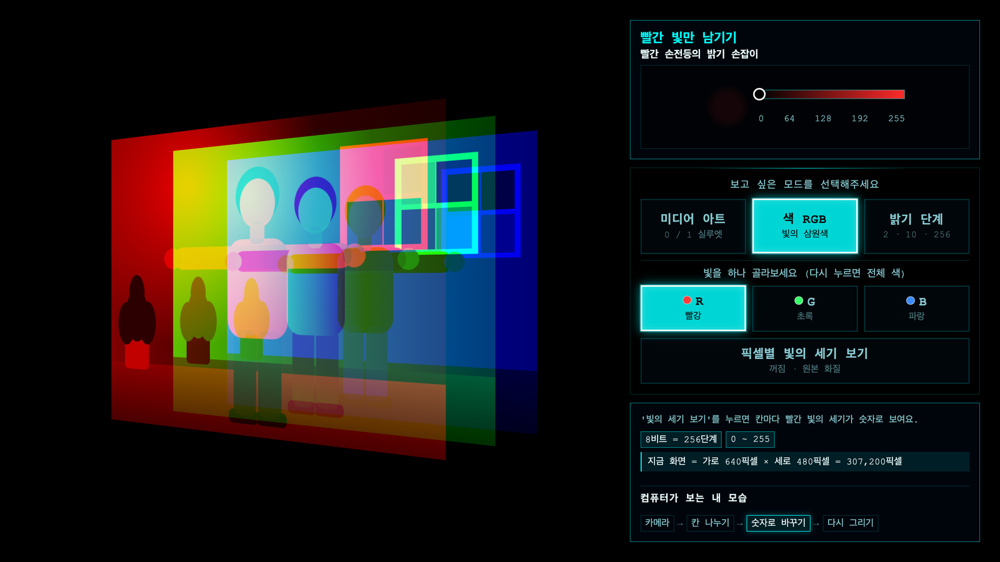

> README의 화면은 실제 카메라 대신 그린 가상 장면(팔을 벌린 사람)과 가상 인물 인식 결과로 캡처했습니다.

## 한눈에 보기

| 미디어 아트 | 색 RGB | 밝기 단계 |
| :---: | :---: | :---: |
| 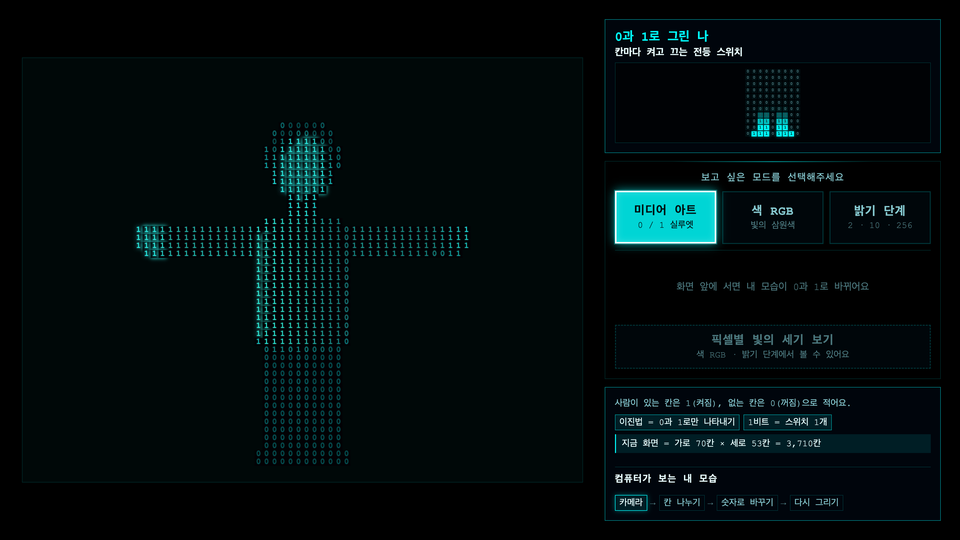 | 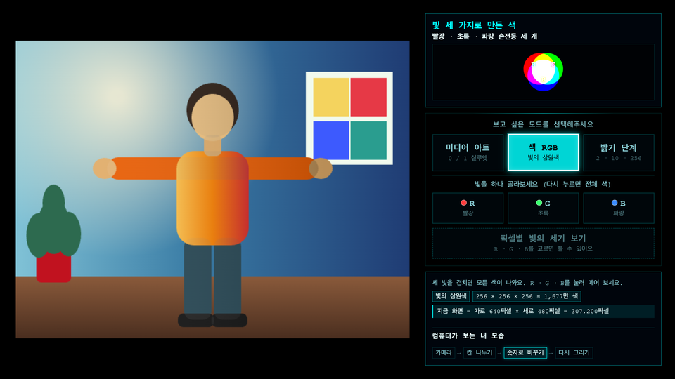 | 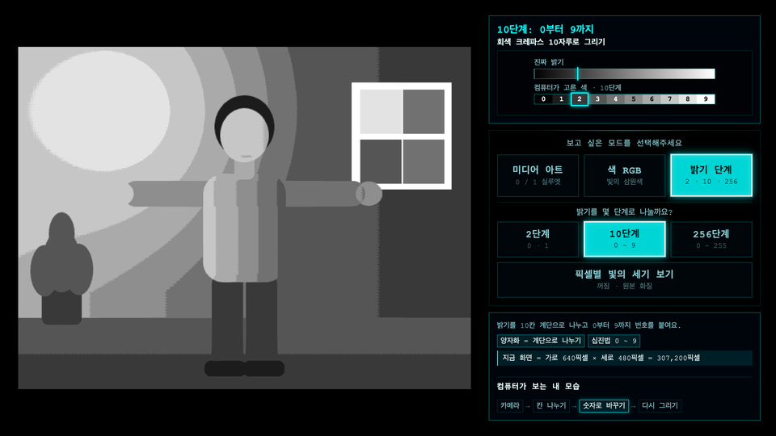 |
| 인공지능이 찾은 사람을 **0과 1**로 그려요 | 화면의 색을 **빨강·초록·파랑 빛** 세 장으로 나눠요 | 밝기를 **2·10·256단계** 계단으로 나눠요 |

## 화면 구성

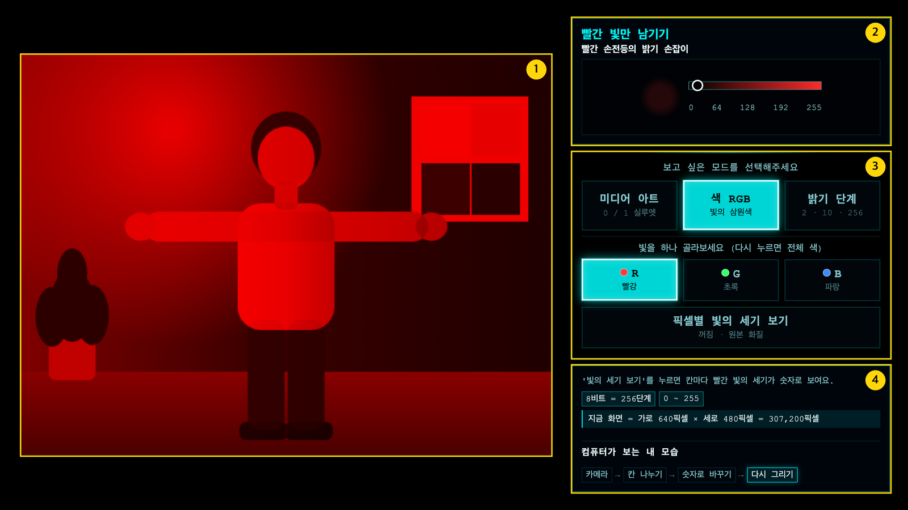

그림의 번호는 아래 목록의 번호와 같습니다.

1. **작품 화면**: 세 모드 모두 같은 자리에 카메라 화면 전체를 맞춰 그립니다.
2. **비유 · 애니메이션**: 지금 보는 화면의 원리를 그림 하나로 보여줍니다.
3. **누르는 버튼**: 모드, 세부 보기, 픽셀 숫자 버튼이 화면 세로 정중앙에 모여 있습니다. 모드를 바꿔도 버튼 위치는 그대로입니다.
4. **설명 · 용어 · 지금 화면**: 한 줄 설명, 용어(이진법, 8비트 등), 지금 화면의 칸·픽셀 수, 화면이 만들어지는 순서를 보여줍니다.

## 모드

### 미디어 아트: 0과 1로 그린 나

인공지능이 카메라에서 사람이 있는 칸을 찾고, 그 칸의 밝기에 따라 0 또는 1을 적습니다. 사람이 없는 칸은 비워 둡니다.

### 색 RGB: 빛 세 가지로 만든 색

카메라 화면을 **원본 화질** 그대로 보여줍니다. `R`/`G`/`B`를 누르면 세 빛이 옆으로 벌어진 뒤 고른 빛만 남고, 같은 버튼을 한 번 더 누르면 다시 합쳐집니다.


| 빨강(R)만 남긴 화면 | 픽셀별 빛의 세기 보기 |
| :---: | :---: |
| 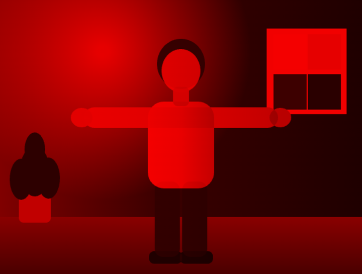 | 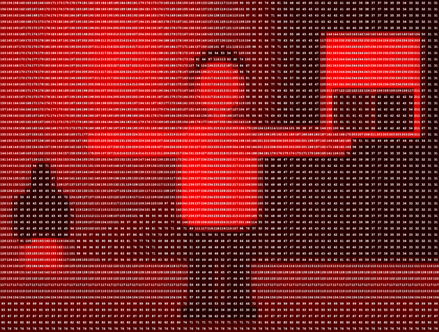 |

확대하면 칸마다 빨간 빛의 세기(`0`~`255`)가 적혀 있습니다.

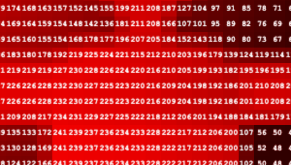

### 밝기 단계: 크레파스 몇 자루로 그릴까

카메라 화면의 밝기를 원본 화질에서 계단처럼 나눕니다. 단계가 많을수록 사진에 가까워집니다.

| 2단계 (`0`·`1`) | 10단계 (`0`~`9`) | 256단계 (`0`~`255`) |
| :---: | :---: | :---: |
| 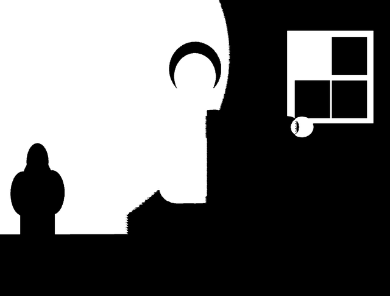 | 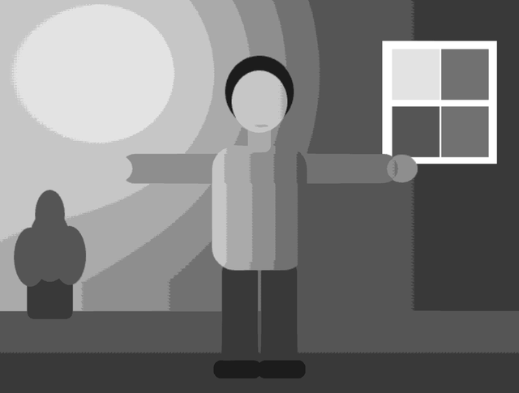 | 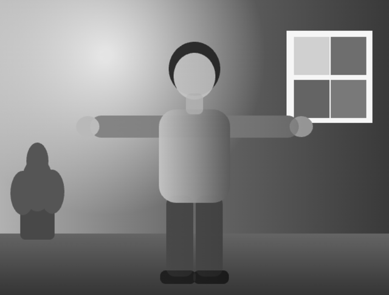 |

픽셀별 빛의 세기 보기를 켜면 칸마다 단계 번호가 적힙니다.

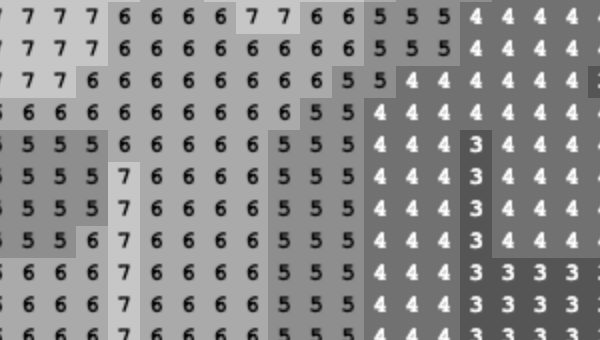

## 픽셀별 빛의 세기 보기

원본 화질 화면과 칸마다 숫자가 적힌 화면을 오가는 큰 버튼입니다. 색 RGB의 `R`/`G`/`B`와 밝기 단계에서만 켤 수 있고, 다른 화면에서는 자리를 지킨 채 안내만 보여줍니다.

| 빛을 고르기 전 (비활성) | 꺼짐 · 원본 화질 | 켜짐 · 칸마다 숫자 |
| :---: | :---: | :---: |
| 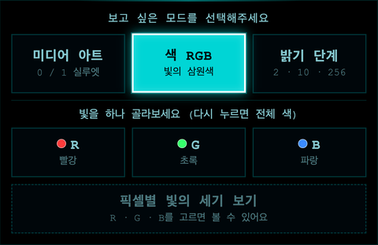 | 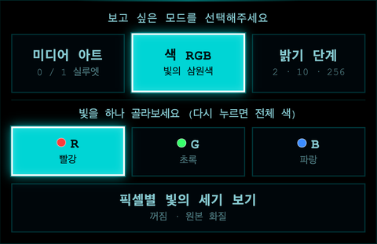 | 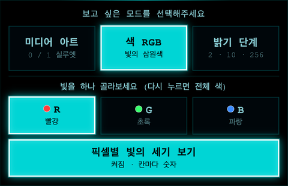 |

## 설명 카드

수식 대신 비유와 짧은 애니메이션으로 원리를 보여줍니다. 오래 읽지 않아도 감으로 익힐 수 있게 문장은 한 줄로 줄였습니다.

| 미디어 아트 | 색 RGB | R · G · B | 밝기 단계 |
| :---: | :---: | :---: | :---: |
| 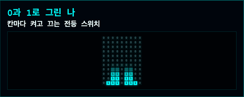 | 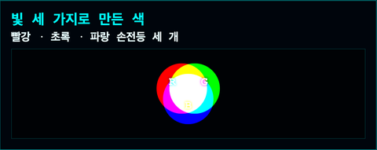 | 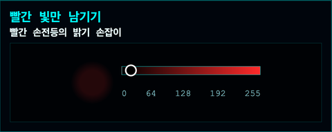 | 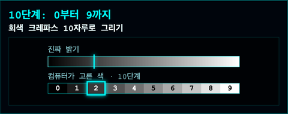 |
| 전등 스위치: 스캔선이 지나가며 사람 칸이 0에서 1로 켜져요 | 손전등 세 개: 세 빛이 겹치면 흰색이 돼요 | 밝기 손잡이: 손잡이 위치가 0~255 값이에요 | 크레파스: 매끈한 밝기와 계단 색을 나란히 보여줘요 |

## 조작

| 하고 싶은 것 | 터치 | 키보드 |
| --- | --- | --- |
| 모드 고르기 | `미디어 아트` / `색 RGB` / `밝기 단계` | `1` / `2` / `3` |
| 빛 하나 고르기 · 풀기 | `R` / `G` / `B` (한 번 더 누르면 전체 색) | |
| 밝기 단계 고르기 | `2단계` / `10단계` / `256단계` | |
| 칸마다 숫자 보기 | `픽셀별 빛의 세기 보기` | |
| 종료 | | `Esc` |

## 실행

```bash
npm install
npm start
```

## 개발

```bash
npm test
npm run lint
```

- **문구 고치기**: 설명 카드 문구는 [src/renderer/data/modeExplanations.js](src/renderer/data/modeExplanations.js), 모드·세부 버튼은 [src/renderer/data/modeOptions.js](src/renderer/data/modeOptions.js)에 있습니다.
- **칸 크기**: [src/renderer/config.js](src/renderer/config.js)의 `FONT_SIZE`(기본 `16px`)로 정합니다. 작게 하면 더 촘촘해지고, 바꾼 뒤 앱을 다시 실행해야 적용됩니다.
- **카메라 해상도**: [src/renderer/core/camera.js](src/renderer/core/camera.js)에서 `640×480`을 요청합니다. 원본 화질 화면도 이 해상도로 나옵니다.
- **숨은 모드**: 키보드 `4`~`8`은 예전 모드(부산 수학문화관, 픽셀 수치, RGB, 8비트 회색, 4비트 컬러)입니다.

### 코드 구조

| 위치 | 하는 일 |
| --- | --- |
| `src/renderer/renderer.js` | 상태, 버튼, 카메라 시작을 묶는 진입점 |
| `src/renderer/core/frameLoop.js` | 매 프레임 카메라를 읽어 모드별로 그림 |
| `src/renderer/core/channelOverlay.js` | WebGL로 원본 화질 영상, RGB 레이어, 밝기 단계를 그림 |
| `src/renderer/modes/` | 모드별 칸·숫자 그리기와 RGB 전환 애니메이션 |
| `src/renderer/ui/` | 설명 카드, 애니메이션, 처리 순서 표시 |
| `src/renderer/data/` | 모드·버튼 규칙과 설명 문구 |
